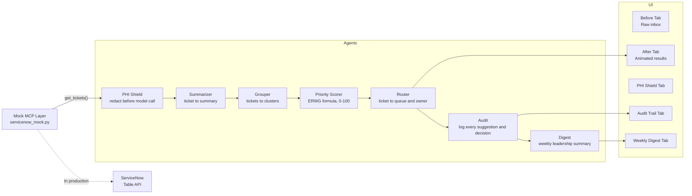

# Triage Copilot: Demo Guide

**Hackathon:** Keck Medicine of USC · Agentic AI in Healthcare  
**Team:** Data Engineering  
**Prototype:** Triage Copilot v0.3 (hackathon build)

---

## One-sentence pitch

> "An AI agent that reads the on-call queue, groups duplicates, scores tickets by ERWG clinical impact, and routes each one — cutting triage time from 3.8 hours to ~33 minutes."

What judges see: a split Before/After demo. Click **Run Triage**, watch four agent steps animate in ~6 seconds, then walk through the results. Optional add-on tabs show PHI de-identification, human approval with a full audit trail, and a weekly leadership digest.

---

## Pre-demo checklist

- [ ] `streamlit run app.py` is running at `http://localhost:8501`
- [ ] Browser tab is open to the app, full-screen, 1080p or wider
- [ ] Sidebar sliders are at defaults: Manual = 6 min, Review = 1.5 min
- [ ] **After** tab is showing only the "Run Triage" button (no results yet)
  - If results are showing: click **Reset**
- [ ] "Reviewing as" sidebar picker is set to your name (for the add-on walkthrough)
- [ ] Screen recording software is armed (if recording)
- [ ] Phone/Slack notifications silenced

---

## Step-by-step timing table (4-5 min version)

| Time | Tab | Action | What to say |
|------|-----|---------|-------------|
| 0:00 | Before | Show the raw inbox | "This is what on-call sees today: 38 tickets, no scores, no grouping." |
| 0:20 | Before | Point to red callout | "Before any ticket is worked, a Business Analyst must schedule a call with the requester, gather the details, manually score 5 ERWG dimensions, and compute the priority. This PHI exposure has been sitting unassigned for 11 hours waiting for that process to begin." |
| 0:45 | Before | Point to orange callout | "22 of these 38 tickets are about the same underlying problems. Without grouping, the analyst investigates each one separately, and callers get separate responses." |
| 1:00 | Before | Expand the Excel mock | "Today the team fills in a shared Excel sheet by hand: 5 ERWG columns, no audit trail, no consistency." |
| 1:15 | After | Switch to After tab | "Here's what the AI agent does instead." |
| 1:25 | After | Click **Run Triage** | "Four agents run in sequence." (let animation play, ~6 s) |
| 1:30 | After | Animation step 1 | "Summarizer: plain-English summary of every ticket." |
| 1:35 | After | Animation step 2 | "Grouper: finds the duplicate clusters." |
| 1:40 | After | Animation step 3 | "Priority Scorer: ERWG formula, 0-100 score." |
| 1:45 | After | Animation step 4 | "Router: assigns each issue to the right team and owner." |
| 1:55 | After | KPI panel | "38 tickets, 22 unique issues. 2 Critical surfaced automatically. Estimated triage time: 33 minutes vs 3.8 hours — 86% reduction." |
| 2:10 | After | First Critical card (PHI) | "The PHI ticket is now at the top, scored 86/Critical. Click 'Why this score' to see the ERWG breakdown." |
| 2:25 | After | Score breakdown expander | Walk through the 5-row ERWG table: org impact multiplier, patient safety, compliance, financial, utilization. |
| 2:45 | After | Needs More Info card | "For vague tickets, the agent flags them and lists exactly what the BA needs to ask — no wasted meeting." |
| 3:05 | After | Duplicate Groups tab | "The Cerner ADT failure: 7 tickets collapsed into one issue. Callers get one consistent response." |
| 3:25 | After | Routing tab + team filter | "Each issue routes to the right queue. A team member can filter to see only their tickets." |
| 3:45 | After | Triage a new ticket | Type a short incident description, click **Score and route this ticket**. |
| 4:10 | | Q&A / wrap-up | See Q&A section below. |

---

## Add-on: PHI shield, human review, weekly digest (+2 min)

Slot these in after the Triage queue walkthrough. Before you start, pick a reviewer in the sidebar ("Reviewing as").

| Time | Tab | Action | What to say |
|------|-----|--------|-------------|
| +0:00 | After → Triage queue | Point at the gray "AI suggestion · awaiting review" pill, open a card, click **✅ Approve** | "The AI suggests; a person decides. Nothing is written back to ServiceNow until someone approves." |
| +0:15 | After → Triage queue | On another card, **✏️ Override** → pick a priority, type a reason → **Save override** | "If the reviewer disagrees, they override, and the reason is required. Those reasons become training examples for the scoring." |
| +0:30 | After → Triage queue | On a ⚠️ card, **📨 Send questions to requester** | "Instead of booking a meeting, the BA sends the AI's questions with one click." |
| +0:40 | 🧾 Audit Trail | Show the newest rows and the agreement rate | "Every AI suggestion and every human decision, with who, when and why. Agreement rate is our accuracy KPI for a pilot." |
| +1:00 | 🛡️ PHI Shield | Show the side-by-side on the first example | "Patient identifiers are stripped before the model sees the text. MRNs, dates of birth, account numbers, phones, addresses and patient names become placeholders, and caller details and attachments are never sent." |
| +1:20 | After → Triage a new ticket | Pick **Ticket containing patient identifiers (PHI shield)** → **Score & route** | "Same shield runs on every new ticket before it's scored." |
| +1:35 | 📈 Weekly Digest | Headline, "Needs attention", charts | "And for leadership: a weekly digest. The ADT load failure has hit 4 of the last 9 weeks, so the digest recommends a permanent fix, not another re-run." |

**Q&A for the add-ons**

**"What counts as PHI here, and how good is the detection?"**
The demo catches MRN/MR# (including letter prefixes), FIN/CSN/encounter and account numbers, SSNs in any common format, dates of birth and other full dates, phone numbers with or without separators, emails, street addresses, ZIP codes, and patient names (after "patient"/"pt", "Last, First", Mr./Mrs./Ms., or a common first name + surname). It's pattern-based, so unusual formats can still slip through; production would add a clinical de-identification model and log only identifier *types and counts*, never values. The 38 synthetic tickets contain no identifiers; the try-it examples use fictional ones.

**"Can the AI change tickets on its own?"**
No. Every write-back (assign, priority change, work note) happens only after a named reviewer approves, and it's recorded in the audit trail.

**"Is the digest written by the AI?"**
In the demo it's assembled offline from the numbers so every figure is traceable. In production the model writes the narrative from the same numbers and a manager reviews it before sending. The 8-week trend history is synthetic.

---

## 90-second short version

| Time | Action |
|------|--------|
| 0:00 | Show Before tab: raw inbox, red pain point callout |
| 0:20 | Switch to After, click Run Triage |
| 0:30 | Animation plays (4 agent steps) |
| 0:42 | KPI panel: "3.8 hrs to 33 min" |
| 0:55 | PHI ticket at top, 86/Critical, open ERWG breakdown |
| 1:20 | Reset and hand back |

---

## Agent architecture

**Demo mode:** `tickets.json` → MCP mock → Agents (precomputed `ai_*` fields) → UI  
**Production:** ServiceNow MCP → Agents (LLM calls + ERWG rules) → ServiceNow writes back via PATCH

---

## Q&A cheat sheet

**"Is this connected to real ServiceNow?"**  
No. All 38 tickets are synthetic, generated for this demo. The mock MCP layer (`tools/servicenow_mock.py`) logs every call to the console with the exact endpoint it would hit in production. No real data, no PHI.

**"Where do the priority scores come from?"**  
The ERWG (Enterprise Reporting Working Group) formula:  
`score = (patient_safety x 8 + compliance x 7 + financial x 6 + utilization x 4) x org_multiplier`  
Five dimensions scored 0-4 each, with an organizational impact multiplier (0-100%). Thresholds: Critical >=70, High 50-69, Medium 30-49, Low <=29. Configured in `config/scoring.json`.

**"What happens when a ticket doesn't have enough information?"**  
The agent flags it as Needs More Info and generates a specific list of questions for the BA to ask. Once the BA gets answers, they feed them back to the agent for re-triage. No wasted meeting, no guessing.

**"Why precomputed? Can it score tickets in real time?"**  
Yes. The scorer (`agents/scorer.py`) is a pure function and already runs on the Triage a new ticket tab. Connecting it to a live LLM for the summary step is a config change: set `DEMO_MODE = False` in `agents/summarizer.py` and fill in `_call_llm()`.

**"How does the grouper work?"**  
In this demo, grouping is precomputed from `group_id` fields in the data. In production it would use embedding similarity to cluster semantically related tickets, then an LLM to label each cluster.

**"What is MCP?"**  
Model Context Protocol: an open standard for connecting AI agents to external tools and data sources. The mock layer mirrors the exact ServiceNow Table API endpoints an approved MCP server would expose in production.

**"What would it take to go live?"**  
Three things: (1) a ServiceNow MCP server approved by IT, (2) validated ERWG weights from a historical data study with clinical review, (3) an LLM API key for the Summarizer. Routing and grouping logic can ship as-is for a pilot.

**"What about patient privacy?"**  
Tickets never leave ServiceNow in this architecture: the MCP server runs inside Keck's network boundary. The PHI shield removes identifiers before any text reaches a model. No PHI is sent to a third-party LLM without the same controls that govern current ServiceNow access.

---

## Fallback plan

| Problem | What to do |
|---|---|
| Streamlit won't start | Open `data/tickets.json` and walk through a few raw tickets and their `ai_*` fields by hand |
| Run Triage button hangs | Refresh; if the server died, restart with `streamlit run app.py` |
| Browser layout broken | Try Chrome; zoom out to 80% |
| Score breakdown not showing | Click the expander arrow — collapsed by default |
| Live ticket scorer errors | Fall back to the precomputed cards in the Triage Queue tab |

---

## Recording tips

- Record at 1080p or 1440p, 30 fps minimum.
- Use a browser profile with no extensions visible in the toolbar.
- Full-screen the browser before starting.
- Record a dry run first. The Run Triage animation is 6 seconds; let it breathe instead of talking over it.
- Zoom in (Cmd +) when showing the ERWG breakdown table so all 5 rows are readable.
- Keep mouse movement slow and deliberate on the KPI panel numbers.

---

## Data and responsible AI

**All data is synthetic.** The 38 tickets were generated for this demo. No real patient, employee, or Keck Medicine data. No PHI. Ticket numbers, caller names, descriptions, and clinical scenarios are entirely fictional.

**Scoring weights need validation.** The current ERWG weights in `config/scoring.json` have not been validated against production data. Before clinical deployment, weights should be calibrated with clinical operations and validated against a labeled historical dataset.

**Humans stay in the loop.** The agent suggests; it does not act. Every ticket card requires a named reviewer to approve before anything is written back to ServiceNow. Low-confidence routes are flagged for manual review.

**Explainability.** Every priority score includes the full 5-row ERWG breakdown so the analyst can see exactly why a ticket landed at Critical vs High, and can override with a required reason.

**PHI shield by default.** In the demo, every ticket-text field is routed through `agents/phi_shield.py` before it reaches any model call. Production would add a clinical de-identification model and audit logging (types and counts only).

---

## Next steps / roadmap

| Priority | Item |
|---|---|
| High | Calibrate ERWG scoring weights against 6 months of historical DE tickets |
| High | Connect Summarizer to a Claude model via Anthropic API |
| High | Stand up a ServiceNow MCP server behind Keck's firewall |
| Medium | Run a 2-week pilot with the DE on-call rotation |
| Medium | Add embedding-based grouper (replace precomputed group_id) |
| Medium | Add batch approval for low-complexity triages |
| Low | Extend to other assignment groups (IS Infrastructure, Clinical Apps) |
| Low | Dashboard: week-over-week triage time and queue depth trends |
| Low | Slack/Teams notification for Critical escalations |
